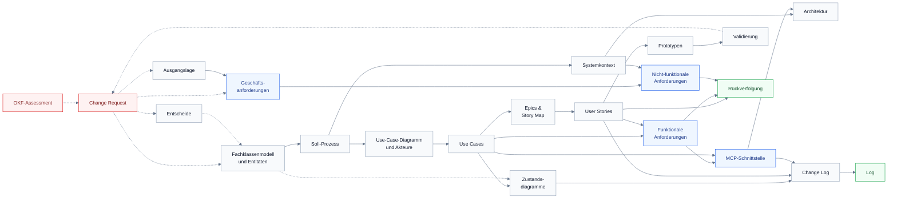

# Produktdokumentation – CredEx Phase 1

## Worum es geht

Die Produktdokumentation von **CredEx Phase 1 – Dokumentenupload über die eigene KI des Partners**, geführt als Bundle im [Open Knowledge Format](https://github.com/GoogleCloudPlatform/knowledge-catalog/blob/main/okf/SPEC.md) (OKF). Erstellt von Gruppe 6 (Marco, Jessica, Cem) für den Leistungsnachweis Modul 2 des [CAS Business Analysis and Methods](https://www.zhaw.ch/de/sml/weiterbildung/detail/kurs/cas-business-analysis-and-methods) an der ZHAW. Grundlage ist das Beispiel [okf-productdocumentation](https://github.com/marcelRonner/okf-productdocumentation) von Marcel Ronner.

**Der Fall.** Partner von CredEx – Banken, Versicherungen, Broker – reichen über die Plattform Hypothekaranträge bei der Glarner KB ein. Heute laden Berater im Schnitt rund 29.5 Dateien einzeln in die Upload-Felder der Pflichtdokumente; das kostet Zeit und führt zu Fehlzuordnungen und unvollständigen Dossiers. In Phase 1 beauftragt der Berater seine **eigene KI** (Copilot, ChatGPT, Claude). Diese legt die Unterlagen über einen **MCP-Server bei CredEx** ab und schlägt je Dokument ein Pflichtdokument mit Konfidenz vor. Der Berater prüft unsichere Zuordnungen in der **Übersicht** und **reicht selbst ein**; jede Aktion landet im **Protokoll**.

Jede Seite ist ein Konzept mit Typ, den Artefakten, aus denen sie abgeleitet ist (`sources`), wer sie wann geschrieben hat (`generated`) und – sobald jemand aus der Gruppe sie freigibt – wer sie geprüft hat (`verified`). Jede Änderung beginnt als **Change Request** in den [Quellen](sources/_index.md). **Jarvis**, ein KI-Agent, hilft bei der Anforderungsanalyse; die Gruppe entscheidet und gibt frei.

## Artefakte

> [!NOTE] v1.3 – Neu 2026-11-07
> Ausgangslage, Rollen und Personas, Architektur, Lösungsoptionen, Prototypen, Validierung, Umsetzung, Entscheide, Rückverfolgung, Freigaben und Glossar.

**Warum und wofür**

- [**Ausgangslage**](problem/ausgangslage.md) – Fall, Ist-Prozess, Leitfrage, Hypothesenbaum und Business Case aus Modul 1
- [**Entscheide**](decisions/entscheide.md) – alle Teamentscheide mit Kontext, Optionen und Folgen
- [**Geschäftsanforderungen**](requirements/geschaeftsanforderungen.md) – GA1 bis GA6, alle messbar

**Wer**

- [**Benutzerrollen**](personas/benutzerrollen.md) – neun Rollen, zwei im Fokus
  - [Sandra Keller](personas/sandraKeller.md) – Kundenberaterin, primäre Persona
  - [Reto Frei](personas/retoFrei.md) – Broker ohne IT, sekundäre Persona

**Was**

- [**Fachklassenmodell**](domain_model/domainModel.md) – zwölf Fachklassen und ihre Beziehungen
  - [Entitäten](domain_model/entities/_index.md) – eine Seite pro Fachklasse
- [**Soll-Prozess**](business_process/businessProcess.md) – BPMN in zwei Teilen, von der KiVerbindung bis zur Prüfung durch die Glarner KB
- [**Systemkontext**](system_context/systemContext.md) – Scope, Nachbarsysteme, Informationsflüsse
- [**Use-Case-Diagramm**](use_case/useCaseDiagram.md) – Akteure und acht Use Cases, jeder mit Aktivitätsdiagramm
  - [Akteurbeschreibungen](use_case/actorDescriptions.md) – Rollen und Systemzugriff
  - [UC-01 KI mit CredEx verbinden](use_case/ki_verbinden/kiVerbinden.md) · [UC-02 Offene Anträge abrufen](use_case/offene_antraege_abrufen/offeneAntraegeAbrufen.md) · [UC-03 Pflichtliste abfragen](use_case/pflichtliste_abfragen/pflichtlisteAbfragen.md) · [UC-04 Dokument ablegen](use_case/dokument_ablegen/dokumentAblegen.md) · [UC-05 Vollständigkeit prüfen](use_case/vollstaendigkeit_pruefen/vollstaendigkeitPruefen.md) · [UC-06 Zuordnung bestätigen oder ändern](use_case/zuordnung_bestaetigen/zuordnungBestaetigen.md) · [UC-07 Antrag einreichen](use_case/antrag_einreichen/antragEinreichen.md) · [UC-09 Nutzung auswerten](use_case/nutzung_auswerten/nutzungAuswerten.md)
- [**Zustandsdiagramme**](state_chart/_index.md) – [Dokument](state_chart/dokumentStateChart.md) und [Antrag](state_chart/antragStateChart.md)
- [**Epics & Story Map**](epics/epics.md) – acht Epics, zwölf Stories in drei Releases
- [**Funktionale Anforderungen**](requirements/funktionaleAnforderungen.md) – FA-01 bis FA-11
- [**Nicht-funktionale Anforderungen**](requirements/nichtfunktionaleAnforderungen.md) – NFA-01 bis NFA-15 nach ISO 25010, Restriktionen R-01 bis R-08

**Wie**

- [**MCP-Schnittstelle**](interface/mcpSchnittstelle.md) – acht Werkzeuge für die Partner-KI
- [**Architektur**](architecture/komponenten.md) – Komponenten und [Ablauf über MCP](architecture/mcpAblauf.md) als Sequenzdiagramm
- [**Nutzwertanalyse**](evaluation/nutzwertanalyse.md) – fünf Optionen, sechs Kriterien, Sensitivität

**Nachweis und Umsetzung**

- [**Prototypen**](prototype/klickprototyp.md) – Klickprototyp und [PoC MCP-Server](prototype/pocMcpServer.md)
- [**Validierung**](validation/validierung.md) – Gespräche mit CTO und Beratenden, [PoC-Test](validation/pocTest.md) heute gegen neu
- [**Umsetzungsplan**](delivery/umsetzungsplan.md) – agil in drei Releases bis zum Go/No-Go

**Qualität der Dokumentation**

- [**Rückverfolgung**](traceability/rueckverfolgung.md) – jede Geschäftsanforderung bis zu Story, Anforderung und Use Case, erzeugt
- [**Freigaben**](traceability/freigaben.md) – welche Artefakte die Gruppe geprüft hat, erzeugt
- [**Glossar**](glossary/glossar.md) – alle Begriffe von A bis Z
- [**Change Log**](change_log/changeLog.md) – Versionen mit vollständiger Rückverfolgung
- [**Quellen**](sources/_index.md) – Change Requests und OKF-Assessments
- [**Log**](log.md) – jede Version und jedes Assessment, neueste zuerst

## Wie die Artefakte zusammenhängen

Die Artefakte bilden eine Ableitungskette: Jedes ist aus dem vorherigen abgeleitet, eine Änderung wandert deshalb immer *flussabwärts*. Gearbeitet wird vom Fachklassenmodell nach aussen. Jede Seite hält ihre Pfeile auch im Frontmatter `sources:` fest.

### Schlüssel

Die Rückverfolgung hängt an wenigen IDs, die wörtlich über die Artefakte zitiert werden – wer eine umbenennt, bricht jeden Verweis darauf.

| Schlüssel | Format | Definiert in | Zitiert von |
|---|---|---|---|
| Prozessschritt | `2.4`, `4.1a` | [Soll-Prozess](business_process/businessProcess.md) | Use Cases, Zeile **Prozessschritte** der [Story Map](epics/epics.md) |
| Use-Case-ID | `UC-04` | [Use-Case-Diagramm](use_case/useCaseDiagram.md) | Story Map, FA, MCP-Schnittstelle, Präsentation |
| Aktivitätslabel | `CredEx-System setzt Dokument (status = UNSICHER)` | Aktivitätsdiagramme (`.puml`) | Übergänge der [Zustandsdiagramme](state_chart/dokumentStateChart.md), *Conversation* der Stories |
| Story-ID | `US-{epic}.{seq}`, dazu Detailkonzept `US-01` | [User Stories](epics/user_stories/_index.md) | Story Map, FA, Change Log |
| Entscheid | `E10` | [Entscheide](decisions/entscheide.md) | Change Requests, betroffene Artefakte |
| Anforderungs-ID | `GA1`, `FA-03`, `NFA-12`, `R-02` | [Anforderungen](requirements/_index.md) und Anforderungs-Excel | Use Cases, Stories, Präsentation |
| Fachklasse und Attribut | `Zuordnung`, `konfidenz` | [Entitäten](domain_model/entities/_index.md) | Jedes Artefakt und seine `tags` |
| Werkzeugname | `credex_dokument_ablegen` | [MCP-Schnittstelle](interface/mcpSchnittstelle.md) | Use Cases, PoC |
| Quellen-id | `business-process`, `cr-1-0` | `sources:` jedes Artefakts | Fussnoten dieses Artefakts |

### Wenn sich das ändert, auch prüfen

| Geändert | Auch prüfen |
|---|---|
| **Entität** – Attribut oder Enum-Wert | Prozessbeschriftungen · Vor- und Nachbedingungen der Use Cases · Zustandsdiagramm der Entität · *Confirmation* der Stories · Parameter der MCP-Schnittstelle |
| **Soll-Prozess** – neuer oder umnummerierter Schritt | Rückverweise der Use Cases · Zeile **Prozessschritte** der Story Map · allenfalls neuer Use Case |
| **Use-Case-Diagramm** – neuer Use Case | Neuer Ordner `use_case/{snake_case}/` mit `.md` und `.puml` · genau ein passendes Epic · Artefaktliste oben |
| **Aktivitätsdiagramm** – geändertes Label | Jeder Übergang, der es zitiert · jede Story, die es zitiert |
| **Anforderung** – neue oder geänderte ID | Anforderungs-Excel der Gruppe · Qualitätsanforderungen der Use Cases · Stories |
| **Entscheid der Gruppe** | Ein neuer Entscheid in [Entscheide](decisions/entscheide.md) (alte nie umschreiben) · die Artefakte unter *Folgen* |
| **Validierung** – neues Ergebnis | Ein Change Request pro Folge · Personas · Stories · Zielwerte der NFA |
| **Alles** | Ein Change Request in den [Quellen](sources/_index.md) · eine Zeile im [Change Log](change_log/changeLog.md) · `make build` läuft durch |

## Mehr dazu

- [README](https://github.com/marcelRonner/okf-productdocumentation#readme) des Originals – Einrichten, Bauen, Deployen
- [Open Knowledge Format](https://github.com/GoogleCloudPlatform/knowledge-catalog/blob/main/okf/SPEC.md) – die Spezifikation hinter dem Frontmatter
- [LLM Wiki](https://gist.github.com/karpathy/442a6bf555914893e9891c11519de94f) – das Muster dahinter
