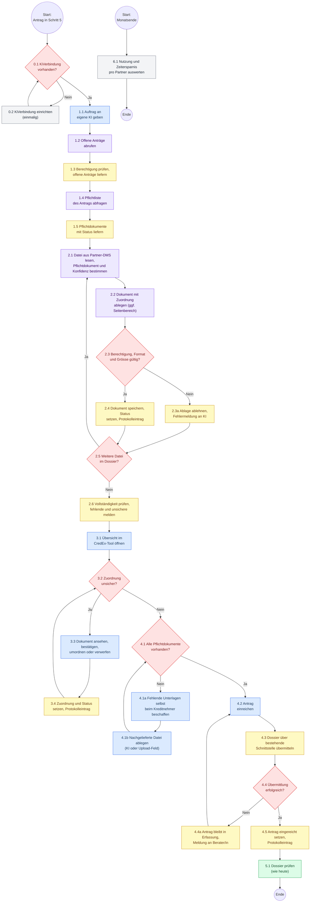

# Soll-Prozess – Dokumentenupload über die eigene KI des Partners

## Überblick

Der Soll-Prozess beschreibt Schritt 5 «Hochladen» eines Antrags in Phase 1: Der Berater beauftragt seine eigene KI, die Partner-KI ruft über den MCP-Server von CredEx den Antrag und die Pflichtdokumente ab, legt jedes Dokument mit einer Zuordnung und Konfidenz ab, der Berater prüft unsichere Zuordnungen in der Übersicht und reicht selbst ein. Die Glarner KB prüft das Dossier wie heute. Die Begriffe stammen aus dem [Fachklassenmodell](../domain_model/domainModel.md); die Systeme und Informationsflüsse zeigt der [Systemkontext](../system_context/systemContext.md). Grundlage ist das BPMN-Modell der Gruppe (`CredEx_Sollprozess_Phase1.bpmn`, Stand 23.10.2026), nachgeführt auf die Entscheide in [CR-1.0](../sources/cr_1_0.md).

---

## Prozessdiagramm

**Legende:** 🟦 Berater/in &nbsp; 🟪 Partner-KI &nbsp; 🟨 CredEx-System &nbsp; 🟩 Glarner KB &nbsp; ⬜ Partner-IT / Partnermanagement &nbsp; 🟥 Entscheidung

---

## Änderungen gegenüber heute

- **Fällt weg:** Sammel-PDFs von Hand trennen und jedes der Pflichtdokumente einzeln in sein Upload-Feld laden.
- **Neu:** Die Partner-KI legt ab (2.1 – 2.5), der Berater prüft nur noch die unsicheren Zuordnungen (3.2 – 3.4).
- **Neu:** Fehlende Pflichtdokumente sind vor dem Einreichen sichtbar (2.6, 4.1) statt erst bei der Prüfung durch die Glarner KB.
- **Bleibt:** Nur der Berater reicht ein (4.2); die Partner-KI kann nicht einreichen. Fehlende Unterlagen beschafft der Berater selbst (4.1a), CredEx fordert nichts beim Kreditnehmer an.
- **Bleibt:** Übermittlung an die Glarner KB über die bestehende Schnittstelle (4.3) und Prüfung wie heute (5.1).
