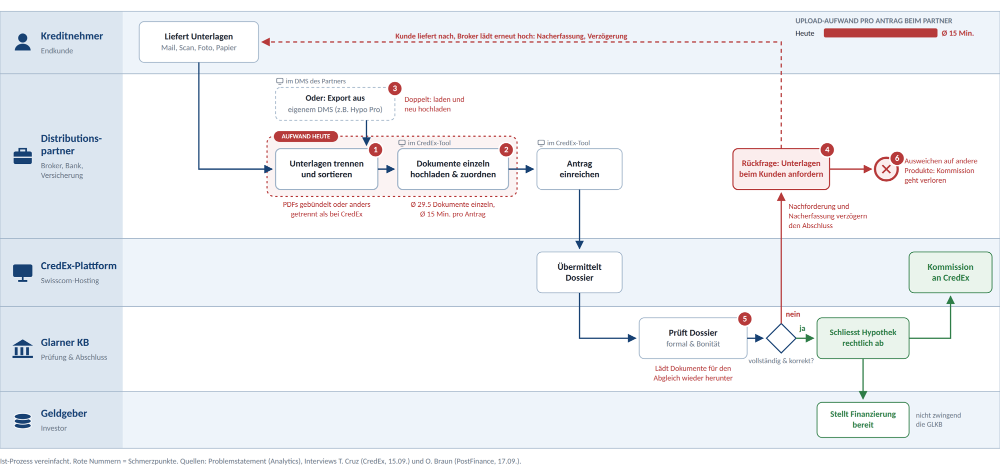

# Ausgangslage – CredEx Phase 1

Modul 1 hat ein Grobkonzept mit Business Case erarbeitet (Note 5); der Verwaltungsrat hat Phase 1 freigegeben. Diese Seite fasst zusammen, worauf das Detailkonzept aufbaut. Quelle aller Zahlen: Präsentation und Business-Case-Modell LNW Modul 1 (02.10.2026), Interviews mit T. Cruz, CTO CredEx (15.09.2026), und O. Braun, Projektleiter Hypotheken PostFinance (17.09.2026).

---

## Der Fall

CredEx (Credit Exchange) ist ein B2B-Marktplatz für Hypotheken. Partner – Banken, Versicherungen und über 100 Broker – erfassen Hypothekaranträge im CredEx-Tool; Anleger finanzieren sie, die Glarner KB prüft das Dossier und schliesst die Hypothek rechtlich ab.

| Kennzahl | Wert |
|---|---|
| Transaktionen auf der Plattform | > 12 000 |
| Vermitteltes Hypothekarvolumen | > CHF 5 Mia. |
| Dokumente pro Antrag | Ø 29.5, jedes einzeln hochgeladen |
| Upload-Felder im Testantrag D226894 | 18 Pflichtfelder, dazu 5 bis 10 Formulare aus dem Prozess |
| Ertrag CredEx | Kommission pro Abschluss (grösste Quelle), jährlicher Mitgliederbeitrag |

---

## Ist-Prozess

Schmerzpunkte: (1) Unterlagen trennen und sortieren, weil Kunden anders bündeln, als CredEx verlangt; (2) Ø 29.5 Dokumente einzeln hochladen und zuordnen, oft liegen sie schon im DMS des Partners; (3) Rückfragen bei fehlenden Unterlagen; (4) die Glarner KB lädt Dokumente zum Abgleich wieder herunter; (5) Partner weichen auf andere Produkte aus.

---

## Leitfrage

> Wie senken wir die Dauer bis zur Einreichung eines Antrags beim Partner durch einen einfacheren Upload um 30 % (Ø 45 auf 31.5 Min.) innerhalb von 6 Monaten nach Go-live, ohne dass Vollständigkeit und Qualität sinken?

Daraus folgt [GA1](../requirements/geschaeftsanforderungen.md). Von den 45 Minuten entfallen heute Ø 15 auf den Upload; der Upload muss also auf ca. 1.5 Minuten sinken, damit die 30 % erreicht werden.

---

## Hypothesenbaum

| Ast | Hypothese | Status |
|---|---|---|
| Sortieren fällt weg | Die KI ordnet Geschäftsdokumente zu über 90 % richtig zu | belegt (Praxisfall Associa, 95 % bei 8 Dokumenttypen) |
| | Berater übernehmen den KI-Vorschlag nach einem Qualitätsnachweis | im Pilot zu testen → [PoC-Test H2](../validation/pocTest.md) |
| Einzel-Upload fällt weg | Upload inklusive Kontrolle dauert unter 2 Minuten | im Pilot zu testen → [PoC-Test H1](../validation/pocTest.md) |
| | Grosspartner lassen ihre eigene KI über MCP hochladen | **offen, grösstes Risiko** → [Validierung V1, V2](../validation/validierung.md) |
| Qualität bleibt gleich | Rückfragen entstehen heute durch fehlende Dokumente | belegt (Interviews) |
| | Eine Pflichtliste zeigt Lücken vor dem Einreichen | im Pilot zu testen → [UC-05](../use_case/vollstaendigkeit_pruefen/vollstaendigkeitPruefen.md) |

Das grösste Risiko wird zuerst getestet: Pilot mit MCP, danach integrierte CredEx-KI für alle.

---

## Lösungsentscheid

Modul 1 hat drei Varianten verglichen: A nur integrierte CredEx-KI, B nur MCP, C zuerst MCP, dann integrierte KI. Gewählt wurde **C**, weil sie als einzige beide Partnertypen abdeckt (mit und ohne eigene KI) und schon ab Jahr 1 Ertrag bringt ([E01](../decisions/e01VarianteZuerstMcp.md)). Modul 2 detailliert nur Phase 1 ([E02](../decisions/e02ScopeNurPhase1.md)); die Bewertung der Optionen für Phase 1 steht in der [Nutzwertanalyse](../evaluation/nutzwertanalyse.md).

---

## Business Case

| Kennzahl | Wert |
|---|---|
| Kapitalwert (NPV, 5 Jahre, 10 %) | + CHF 34'186 |
| Interner Zinsfuss | 25.6 % |
| Amortisation (dynamisch) | ca. 2.9 Jahre |
| ROI über 5 Jahre | 32.9 % |
| Investition Jahr 0 (MCP-Phase) | CHF 71'840 |
| Investition Jahr 1 (integrierte KI) | CHF 85'920, erst nach Go/No-Go |

Annahmen: 5 Grosskunden gestaffelt 2027 bis 2029, Nutzungsgebühr CHF 10 pro Fall, begründet mit ca. 15 eingesparten Minuten (CHF 35) pro Antrag beim Partner. Hebel: Ohne Kostenbeteiligung der Glarner KB (Annahme 25 %) wird der NPV negativ (CHF −1'417); ±25 % Initialkosten verschieben den NPV zwischen CHF 7'289 und 61'083. Tokenkosten sind kein Hebel (CHF 1.13 pro Fall). Der Business Case wird nach dem PoC-Test mit gemessener Zeit nachgeführt ([Umsetzungsplan](../delivery/umsetzungsplan.md)).

---

## Feedback Modul 1 und Antwort

| Feedback des Dozenten | Antwort in Modul 2 | Artefakt |
|---|---|---|
| Auf einen der beiden Fälle fokussieren | Nur Phase 1: Partner mit eigener KI über MCP | [E02](../decisions/e02ScopeNurPhase1.md), [Systemkontext](../system_context/systemContext.md) |
| Per PoC zeigen, dass das Konversations-LLM die Arbeit erleichtert | Lauffähiger MCP-Server, Test heute gegen neu | [PoC](../prototype/pocMcpServer.md), [PoC-Test](../validation/pocTest.md) |
| Anforderungen besser verstehen und validieren | Gespräche mit CTO und Beratenden | [Validierung](../validation/validierung.md) |
| Konzeptionelle Unklarheiten, Medienbruch KI-Chat und CredEx-Tool | Bestätigen auch per Auftrag an die KI; Ablauf als Sequenzdiagramm | [E10](../decisions/e10BestaetigenPerKiAuftrag.md), [MCP-Ablauf](../architecture/mcpAblauf.md) |
| Warum kein Drag & Drop schon in der MCP-Phase? | Option D in der Nutzwertanalyse bewertet | [Nutzwertanalyse](../evaluation/nutzwertanalyse.md), [E11](../decisions/e11OptionDragAndDrop.md) |
| Einsparung GLKB, kombinierte Szenarioanalyse | Business Case nach dem PoC nachführen | [Umsetzungsplan](../delivery/umsetzungsplan.md) |
| Folien teilweise textlastig | Präsentation mit Diagrammen und Live-Demo; Details in dieser Dokumentation | – |
