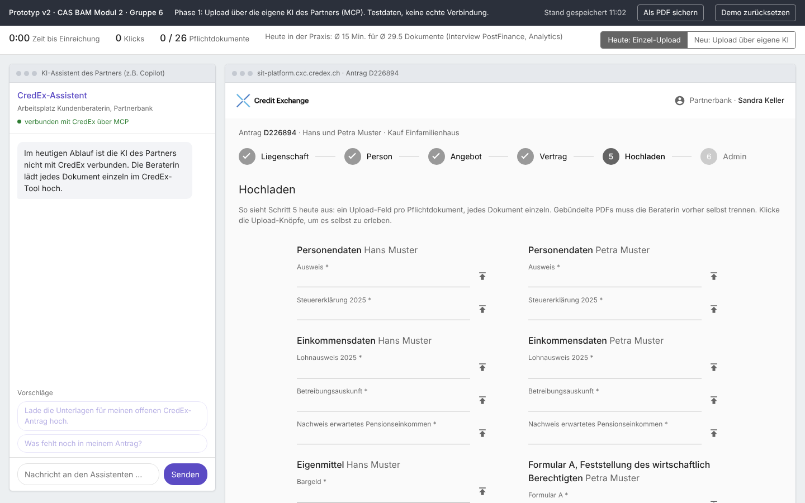
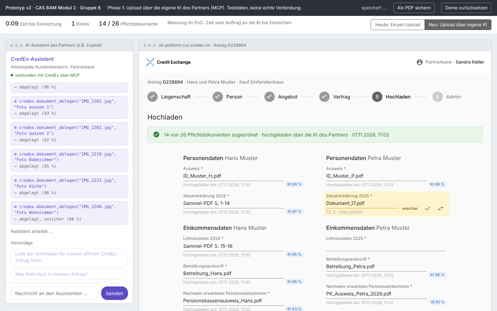

# Prototyp – Klickprototyp MCP-Upload

## Zweck

Den Ablauf für Beratende greifbar machen, bevor etwas gebaut ist: Wie fühlt sich der Upload über die eigene KI an, was zeigt die Übersicht, wo muss die Beraterin eingreifen? Der Prototyp dient den [Validierungsgesprächen V2](../validation/validierung.md) und macht den Unterschied heute gegen neu in der Präsentation sichtbar. Er beantwortet damit die Rückfrage aus Modul 1 zum UI-Mockup.

## Art

- **Horizontal:** zeigt die ganze Oberfläche von Schritt 5, aber ohne echte Logik dahinter.
- **Mittlere Wiedergabetreue:** Layout, Stepper, Upload-Felder und Logo wie in der CredEx-Plattform (Testantrag D226894), Daten fiktiv.
- **Werkzeug:** eine HTML-Datei (`CredEx_Prototyp_MCP_Upload_v2.html`), läuft offline im Browser; misst Zeit und Klicks.

## Screens

*Heute: Die KI ist nicht verbunden; jedes der 26 Pflichtdokumente wird einzeln hochgeladen.*

*Neu: Links ruft die Partner-KI `credex.dokument_ablegen` auf, rechts füllt sich die Übersicht. Unsichere Zuordnungen sind gelb und werden mit ✓ bestätigt oder mit ⇄ geändert.*

## Abgedeckte Stories

[US-2.1](../epics/user_stories/us_2_1.md), [US-4.1](../epics/user_stories/us_4_1.md), [US-4.2](../epics/user_stories/us_4_2.md), [US-5.1](../epics/user_stories/us_5_1.md), [US-6.1](../epics/user_stories/us_6_1.md), [US-6.2](../epics/user_stories/us_6_2.md), [US-7.1](../epics/user_stories/us_7_1.md)

## Stand und Abweichungen

Version 2 vom 07.11.2026, auf dem Stand der Entscheide [E05](../decisions/e05NachfordernNichtImScope.md) und [E09](../decisions/e09EinreichenNurVollstaendig.md). Der Prototyp zählt 26 Pflichtdokumente nach den Regeln der Plattform; der PoC und das Detailkonzept arbeiten mit den 18 Feldern des Testantrags. Noch nicht gezeigt: Bestätigen per Auftrag an die KI ([US-6.3](../epics/user_stories/us_6_3.md)) – das zeigt der [PoC](pocMcpServer.md).
