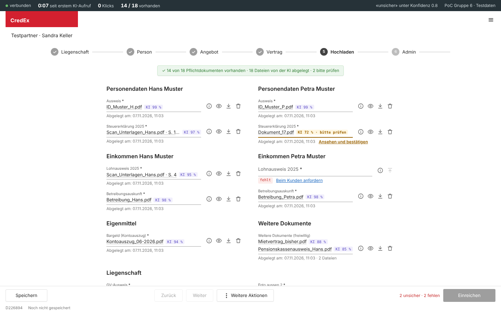

# Prototyp – PoC MCP-Server

## Zweck

Belegen, dass das Konversations-LLM die Arbeit wirklich erleichtert (Feedback Modul 1) und dass die Technik trägt: Kann eine handelsübliche KI über MCP einen Antrag finden, ein Sammel-PDF aufteilen, 17 Dateien mit ehrlicher Konfidenz ablegen? Der PoC ist das Werkzeug für den [PoC-Test](../validation/pocTest.md) mit Beratenden.

## Art

- **Vertikal:** ein durchgehender Durchstich durch alle Schichten – KI, MCP-Server, Ablage, Übersicht, Protokoll –, aber nur für einen Testantrag.
- **Hohe Wiedergabetreue in der Logik**, mittlere in der Oberfläche.
- **Technik:** Python mit dem offiziellen MCP-SDK (`credex_mcp_poc.py`), getestet mit Claude Desktop; Übersicht im Browser unter `http://127.0.0.1:8765`; Zustand als JSON; Messung in `messungen.csv`.
- **Werkzeuge:** die acht der [MCP-Schnittstelle](../interface/mcpSchnittstelle.md), dazu `dms_dateien_auflisten` und `dms_datei_lesen` als Simulation des Partner-DMS.

## Screens

*Übersicht nach einem Testlauf am 07.11.2026: Die KI hat das Sammel-PDF von Hans in Steuererklärung (S. 1–3) und Lohnausweis (S. 4) geteilt, Dokument_17 als Steuererklärung von Petra mit 72 % erkannt (unter der Schwelle, «bitte prüfen»). Lohnausweis Petra und Grundbuchauszug fehlen absichtlich. Einreichen ist gesperrt.*

## Abgedeckte Stories

[US-2.1](../epics/user_stories/us_2_1.md), [US-3.1](../epics/user_stories/us_3_1.md), [US-4.1](../epics/user_stories/us_4_1.md), [US-4.2](../epics/user_stories/us_4_2.md), [US-5.1](../epics/user_stories/us_5_1.md), [US-6.1](../epics/user_stories/us_6_1.md), [US-6.2](../epics/user_stories/us_6_2.md), [US-6.3](../epics/user_stories/us_6_3.md), [US-7.1](../epics/user_stories/us_7_1.md)

## Stand und Abweichungen

Stand 30.10.2026. Bewusste Vereinfachungen: keine Anmeldung (eine feste Testberaterin), Dateien per Dateiname statt echtem Upload, Speicherung in JSON statt in der Plattform, Konfidenz von der KI selbst geliefert.

Nachzuführen auf die Entscheide vom 30.10. und 07.11.:

| Abweichung im PoC | Entscheid | Massnahme |
|---|---|---|
| Schaltfläche «Beim Kunden anfordern» (im Screenshot sichtbar) | [E05](../decisions/e05NachfordernNichtImScope.md) | entfernen |
| Einreichen mit Begründung bei fehlenden Pflichtdokumenten | [E09](../decisions/e09EinreichenNurVollstaendig.md) | Begründungsfeld entfernen, nur vollständig |
| Protokoll schreibt «Beraterin (via KI)» | [E10](../decisions/e10BestaetigenPerKiAuftrag.md) | auf `BERATER_VIA_KI` vereinheitlichen |
