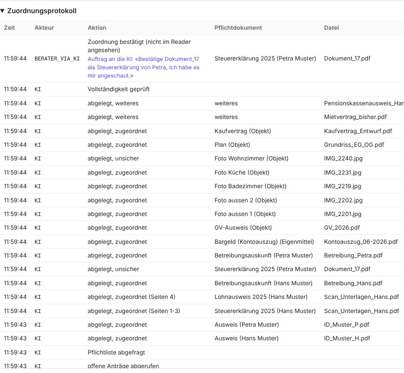

# Prototyp – PoC MCP-Server

## Zweck

Belegen, dass das Konversations-LLM die Arbeit wirklich erleichtert (Feedback Modul 1) und dass die Technik trägt: Kann eine handelsübliche KI über MCP einen Antrag finden, ein Sammel-PDF aufteilen, 17 Dateien mit ehrlicher Konfidenz ablegen? Der PoC ist das Werkzeug für den [PoC-Test](../validation/pocTest.md) mit Beratenden.

## Art

- **Vertikal:** ein durchgehender Durchstich durch alle Schichten – KI, MCP-Server, Ablage, Übersicht, Protokoll –, aber nur für einen Testantrag.
- **Hohe Wiedergabetreue in der Logik**, mittlere in der Oberfläche.
- **Technik:** Python mit dem offiziellen MCP-SDK (`credex_mcp_poc.py`), getestet mit Claude Desktop; Übersicht im Browser unter `http://127.0.0.1:8765`; Zustand als JSON; Messung in `messungen.csv`.
- **Werkzeuge:** die acht der [MCP-Schnittstelle](../interface/mcpSchnittstelle.md), dazu `dms_dateien_auflisten` und `dms_datei_lesen` als Simulation des Partner-DMS.

## Screens

*Übersicht nach einem Testlauf am 07.11.2026: Die KI hat das Sammel-PDF von Hans in Steuererklärung (S. 1–3) und Lohnausweis (S. 4) geteilt und Dokument_17 als Steuererklärung von Petra mit 72 % erkannt, unter der Schwelle. Die Beraterin hat diese Zuordnung per Auftrag an die KI bestätigt («bestätigt via KI»). Das Foto Wohnzimmer ist noch unsicher; Lohnausweis Petra und Grundbuchauszug fehlen absichtlich. Einreichen bleibt gesperrt, bis alles vorhanden ist.*

*Das Zuordnungsprotokoll: Jeder Protokolleintrag nennt den Akteur wie im Fachklassenmodell (`KI`, `BERATER`, `BERATER_VIA_KI`). Bei `BERATER_VIA_KI` steht der Auftrag an die KI im Wortlaut darunter, auch im CSV-Export.*

## Abgedeckte Stories

[US-2.1](../epics/user_stories/us_2_1.md), [US-3.1](../epics/user_stories/us_3_1.md), [US-4.1](../epics/user_stories/us_4_1.md), [US-4.2](../epics/user_stories/us_4_2.md), [US-5.1](../epics/user_stories/us_5_1.md), [US-6.1](../epics/user_stories/us_6_1.md), [US-6.2](../epics/user_stories/us_6_2.md), [US-6.3](../epics/user_stories/us_6_3.md), [US-7.1](../epics/user_stories/us_7_1.md)

## Stand und Abweichungen

Stand 07.11.2026, auf dem Stand aller Entscheide. Bewusste Vereinfachungen: keine Anmeldung (eine feste Testberaterin), Dateien per Dateiname statt echtem Upload, Speicherung in JSON statt in der Plattform, Konfidenz von der KI selbst geliefert.

Am 07.11.2026 nachgeführt:

| Vorher im PoC | Entscheid | Jetzt |
|---|---|---|
| Schaltfläche «Beim Kunden anfordern» und Status «angefordert» | [E05](../decisions/e05NachfordernNichtImScope.md) | entfernt; fehlende Dokumente beschafft die Beraterin selbst, die KI legt sie danach im selben Antrag ab |
| Einreichen mit Begründung bei fehlenden Pflichtdokumenten | [E09](../decisions/e09EinreichenNurVollstaendig.md) | Begründungsfeld entfernt; Einreichen erst, wenn kein Pflichtdokument fehlt und keine Zuordnung unsicher ist, auch serverseitig geprüft |
| Protokoll schreibt «Beraterin (via KI)», Auftrag gekürzt im Aktionstext | [E10](../decisions/e10BestaetigenPerKiAuftrag.md) | Akteur `KI`, `BERATER` oder `BERATER_VIA_KI` wie im [Protokolleintrag](../domain_model/entities/protokolleintrag.md); Auftrag im Wortlaut in einem eigenen Feld |
| Werkzeuge geben deutsche Kurzformen als Status zurück | [MCP-Schnittstelle](../interface/mcpSchnittstelle.md) | Status wie in der Spezifikation: `FEHLT`, `UNSICHER`, `VORHANDEN` und `VON_KI_ZUGEORDNET`, `BESTAETIGT`, `VERWORFEN` |

Für einen vollständigen Testlauf liegen die zwei absichtlich fehlenden Pflichtdokumente im Ordner `testdossier_nachreichung/` des PoC; die Testleitung legt sie als «Nachreichung des Kunden» ins Dossier. Die Vorversion des PoC ist im Gruppenordner archiviert.
