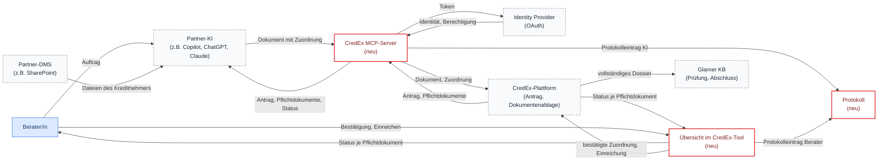

# Systemkontext – CredEx Phase 1

## Überblick

Im Scope von Phase 1 (rot) liegen drei neue Teile von CredEx: der **MCP-Server**, die **Übersicht** im CredEx-Tool (Erweiterung von Schritt 5 «Hochladen») und das **Protokoll**. Alles andere ist Kontext (gestrichelt) und lässt sich nur über Verhandlung ändern: die KI und das Dokumentenablagesystem (DMS) des Partners, der Identity Provider, die bestehende CredEx-Plattform und die Glarner KB. Die Informationen heissen wie im [Fachklassenmodell](../domain_model/domainModel.md); die Abläufe dazu zeigt der [Soll-Prozess](../business_process/businessProcess.md). Grundlage ist das Systemkontextdiagramm der Gruppe (`Systemkontext_Phase1_CredEx.svg`).

---

## Diagramm

**Legende:** rot umrandet = Scope Phase 1 &nbsp; gestrichelt = Kontext &nbsp; Pfeil = gerichteter Informationsfluss

---

## Informationsflüsse

| Von | Nach | Information |
|---|---|---|
| Berater/in | Partner-KI | Auftrag (Prompt), z.B. «Lade die Unterlagen für meinen offenen CredEx-Antrag hoch» |
| Partner-DMS | Partner-KI | Dateien des Kreditnehmers |
| Partner-KI | MCP-Server | Dokument mit Zuordnung (Pflichtdokument, Konfidenz, optional Seitenbereich) |
| MCP-Server | Partner-KI | Offene Anträge, Pflichtdokumente, Ablagestatus |
| MCP-Server | Identity Provider | Token der Anmeldung |
| Identity Provider | MCP-Server | Identität und Berechtigung (Anträge des Teams) |
| MCP-Server | CredEx-Plattform | Dokument und Zuordnung |
| CredEx-Plattform | MCP-Server | Antrag und Pflichtdokumente |
| MCP-Server | Protokoll | Protokolleintrag mit Akteur KI |
| CredEx-Plattform | Übersicht | Status je Pflichtdokument |
| Übersicht | Berater/in | Status je Pflichtdokument mit Datei, Quelle und Konfidenz |
| Berater/in | Übersicht | Bestätigung, Umordnung, Verwerfen, Einreichen |
| Übersicht | CredEx-Plattform | Bestätigte Zuordnung, Einreichung |
| Übersicht | Protokoll | Protokolleintrag mit Akteur Berater |
| CredEx-Plattform | Glarner KB | Vollständiges Dossier über die bestehende Schnittstelle |

---

## Abgrenzung

- Integrierte CredEx-KI und Anbindung der Swiss AI Platform (Phase 2, Go/No-Go nach Monat 12)
- Auslesen von Daten aus den Dokumenten, Prüfprozess der Glarner KB, Anbindung von Kernsystemen der Partner, Gebühren- und Rechnungslogik
- Antragsschritte 1 bis 4 und 6
- Fehlende Unterlagen beim Kreditnehmer anfordern (der Berater fragt selbst nach)
- Herkunft der Zuordnungen (KI oder Mensch) für die Glarner KB sichtbar machen
- Die Verarbeitung durch die Partner-KI liegt in der Verantwortung des Partners
